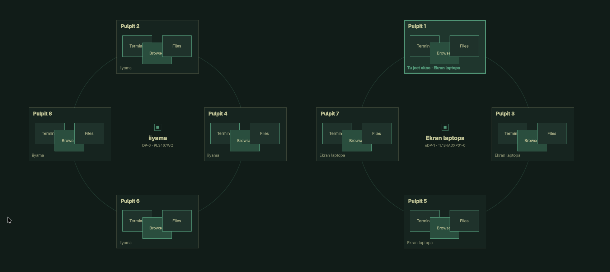

# Workspace Drag for Omarchy

Move a window to any workspace on any monitor by dragging it onto a live overview,
or by holding two modifiers and pressing a digit.



Omarchy 4.5 gives every monitor its own workspaces. Workspace Drag makes that
layout visible at the moment you need it: hold a shortcut over a window and each
monitor appears as a ring of its workspaces, with live thumbnails of what is
already there. Release over a workspace and the window moves there silently,
while every monitor keeps showing what it was showing.

## Features

- **Mouse drag.** Hold `Super + Alt + left mouse button` over a window, point at a
  workspace, release.
- **Keyboard move.** Hold `left Alt + Shift`, press `1`–`5` for a workspace on the
  highlighted monitor, or use the arrow keys and `Enter`.
- **Pinned chooser.** `Alt + Shift + Space` keeps the overview open so you can
  browse with `Tab` and the arrow keys.
- **Per-monitor slots.** Every mapped monitor always shows its five local
  workspaces, including empty ones, so a destination exists before any window
  is opened there.
- **Live thumbnails** of the windows on each workspace, or window titles if you
  prefer.
- **Settings window and bar icon** for the shortcut, dimming, preview size, hover
  zoom and animation preset.
- **Follows your theme.** Colors come from Omarchy's current `colors.toml`,
  rounding from Hyprland.
- **No compiled plugins and no extra packages.** Lua bindings, a small Python
  backend and a standalone Quickshell window.

## Requirements

- Omarchy 4.5 or newer (developed on the edge channel)
- Hyprland with Lua configuration (tested on 0.57.1)
- Quickshell 0.3.2
- Python 3

## Install

```bash
git clone https://github.com/mateuszruszkowski/omarchy-workspace-drag.git
```

```bash
python3 omarchy-workspace-drag/install.py
```

```bash
omarchy plugin enable local.workspace-drag --section centerBegin
```

```bash
hyprctl reload
```

```bash
~/.local/share/workspace-drag/workspace-drag start
```

Run `hyprctl configerrors` afterwards; it should report no errors.

The installer:

- copies the extension to `~/.local/share/workspace-drag`,
- adds one marked `require` line to `~/.config/hypr/bindings.lua` and one marked
  autostart line to `~/.config/hypr/autostart.lua`,
- creates its own `~/.config/hypr/workspace-drag.lua` module,
- installs the `local.workspace-drag` bar widget and a
  **Workspace Drag — Ustawienia** entry in the application menu,
- saves every file it touches under `~/.local/state/workspace-drag/backups/`.

It never reloads Hyprland, starts processes, or changes monitor configuration.

### Update

Pull the repository and run `install.py` again. Your `config.json` and
`shortcut.conf` are kept.

### Uninstall

```bash
~/.local/share/workspace-drag/workspace-drag stop
```

```bash
python3 omarchy-workspace-drag/install.py --uninstall
```

```bash
hyprctl reload
```

Uninstall removes only the marked lines and the extension's own files. The rest
of your configuration and all backups stay. An include module you edited by hand
is kept.

## Usage

### Mouse

Hold `Super + Alt + left mouse button` over a normal window. The monitor under
the pointer dims and shows one ring of workspaces per monitor. A small preview of
the window follows the pointer, and the workspace under it grows.

Release over a workspace to move the window. It leaves fullscreen, becomes tiled
and moves without switching any monitor's active workspace. The pointer returns
to where the drag started, so the next window can be moved right away.

To cancel: release outside a slot, release on the source workspace, press
`Escape`, or hold for longer than 25 seconds. Holds shorter than 120 ms are
ignored.

### Keyboard

Hold `left Alt + Shift` to see the destinations.

| Key | Action |
| --- | --- |
| `1`–`5` | Move to that workspace on the highlighted monitor |
| `0` | Local workspace 10, when it exists |
| `Left` / `Right` | Choose a monitor |
| `Up` / `Down` | Choose a workspace |
| `Enter` | Move to the highlighted workspace |
| `Space` | Pin the chooser (then `Tab` / `Shift + Tab` also switch monitors) |
| `Escape`, or release the modifiers | Cancel |

The source window is the active window by default. The settings window can
switch that to the window under the pointer. Either way the source is captured
when the modifiers go down, so later pointer movement cannot change it.

Right Alt is left alone because it is AltGr on many layouts. The prefix is
inactive inside a non-default Hyprland submap, and existing bindings such as
`Alt + Shift + Tab` keep their actions.

## Settings

Open **Workspace Drag — Ustawienia** from the application menu, click the grid
icon in the bar, or run:

```bash
~/.local/share/workspace-drag/workspace-drag settings
```

The window sets the mouse shortcut, the keyboard prefix, backdrop dimming,
thumbnails or titles, preview size (50–200%), hover zoom (100–135%) and the
animation preset. **Podgląd** (preview) opens the real overview with unsaved
values without grabbing a window. A shortcut that is already bound in Hyprland is
rejected before any file changes. Earlier files are saved under
`~/.local/share/workspace-drag/settings-backups/` and restored if applying fails.

The overview is available in English and Polish and follows Omarchy's language.
The settings window is currently Polish only.

Everything is plain data you can also edit by hand:

| File | Content |
| --- | --- |
| `shortcut.conf` | Mouse chord, for example `SUPER + ALT + mouse:272` |
| `keyboard.conf` | Keyboard prefix, for example `ALT + SHIFT` |
| `keyboard-source.conf` | `active` or `pointer` |
| `config.json` | Appearance and behaviour, see below |

| `config.json` key | Default | Meaning |
| --- | --- | --- |
| `groupColumns` | `0` | Monitor rings per row. `0` picks the largest layout that fits. |
| `cardWidth`, `cardHeight` | `230`, `150` | Logical card size before fitting the display. |
| `cardScale` | `1.0` | Preview size multiplier, 0.5–2.0. |
| `gap` | `24` | Space between slots. |
| `zoom` | `1.15` | Hover scale, 1.0–1.35. |
| `backgroundOpacity` | `0.72` | Backdrop dimming. The desktop stays visible underneath. |
| `animationPreset` | `smooth` | `none`, `quick` or `smooth`. Hyprland's `animations:enabled = false` wins. |
| `previewMode` | `thumbnails` | `titles` shows window titles instead of captures. |
| `hiddenMonitors` | `[]` | Monitor names to leave out, for example a virtual output. The source monitor is always shown. |
| `timeoutSeconds` | `25` | Cancel a hold that got stuck. |
| `pollMilliseconds` | `35` | Pointer update interval during a drag. |
| `restoreCursor` | `true` | Return the pointer to where the drag started. |
| `defaultWorkspaces` | `1`–`10` | Fallback for a monitor without an Omarchy workspace block. |

Appearance changes apply on the next drag. Shortcut changes reload Hyprland.

## How it works

| Part | Role |
| --- | --- |
| `bindings.lua` | Hyprland bindings. Reads the chord from `shortcut.conf` and tags each press and release with a sequence token. |
| `backend.py` | State machine: picks the source window, lays out the cards, hit-tests the pointer, dispatches the move by window address. |
| `shell.qml` | Standalone Quickshell overlay, driven over the `workspaceDrag` IPC target. |
| `settings.qml`, `settings.py` | Settings window and the helper that validates and applies changes atomically. |
| `bar-plugin/` | The `local.workspace-drag` bar widget that opens settings. |
| `install.py` | Installer and uninstaller. |

The overview runs in its own Quickshell process instead of as a plugin inside
Omarchy's shell, which keeps this code out of the process that draws the bar.

Thumbnails use Quickshell's `ScreencopyView` on each window's own Wayland handle.
Nothing captures a whole output, nothing is cached on disk and nothing touches
the network. Window titles stay in the local UI pipe, are rendered as plain text
and are never logged. Workspace names are validated before they reach a
dispatcher, and configuration files are parsed as data, never evaluated as Lua.

## Limits

- Thumbnails of inactive workspaces depend on the application still supplying
  buffers. When it does not, the card shows the application class instead.
- Dynamic workspace selectors such as `w[1-10]` are not expanded.
- Special workspaces are excluded.
- With the keyboard source set to the window under the pointer, an empty spot or
  overlapping windows do nothing: Hyprland's API does not expose stacking order.
- Hyprland cannot tell apart the same modifier held on two keyboards.

## Development

```bash
python3 -m unittest discover -s . -p 'test_*.py' -v
```

The 115 unit tests fake the Hyprland IPC boundary and cover release coordinates,
early release, cancel and timeout, a closed source window, monitor unplug and
scale changes, mixed-scale and rotated hit testing, settings validation, and
install, update and uninstall.

Useful while working on it:

```bash
~/.local/share/workspace-drag/workspace-drag status
```

```bash
~/.local/share/workspace-drag/workspace-drag demo
```

```bash
qs log --path ~/.local/share/workspace-drag/shell.qml --tail 40
```

`demo` draws synthetic workspaces on a solid backdrop without touching any real
window; `cancel` or the timeout closes it. Acceptance runs on a real compositor
are recorded in [VERIFICATION.md](VERIFICATION.md).

## License

[MIT](LICENSE)
